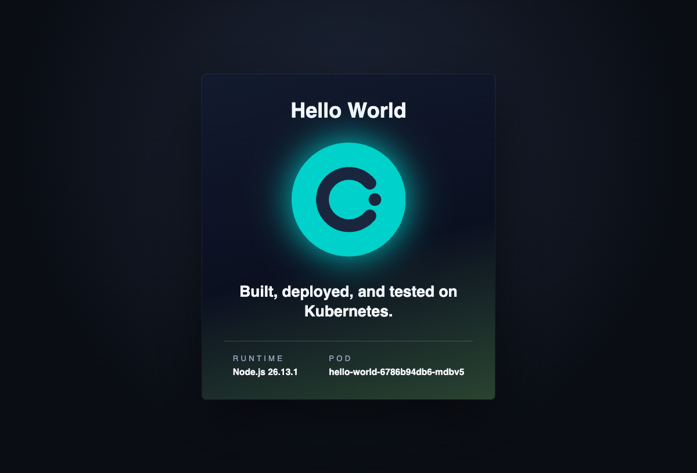

# Getting Started with Okteto and Node.js

This sample shows how to build, deploy, test, and develop a Node.js application on Kubernetes with [Okteto](https://www.okteto.com). The application is a hello world service: its page shows a message, the Node.js version, and the pod that serves it.

Okteto builds its application and development images from the `Dockerfile`, deploys it with `kubectl`, runs its unit tests in the cluster, and replaces it with a Development Container that has hot reload and a debugger.

Follow the [Okteto with Node.js](https://www.okteto.com/docs/development/containers/node/) guide.
